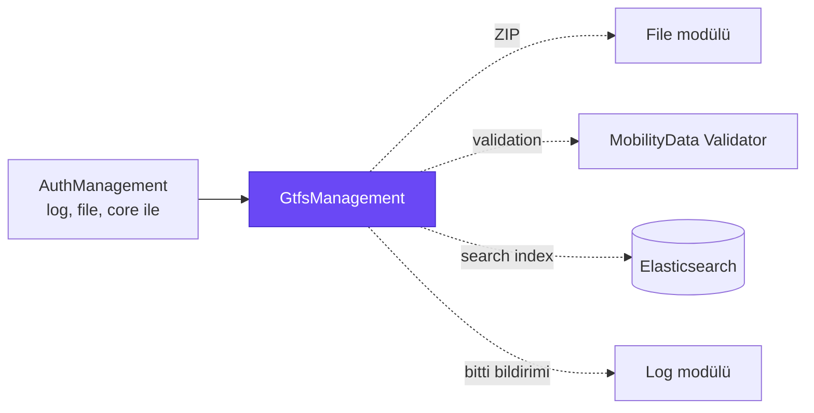
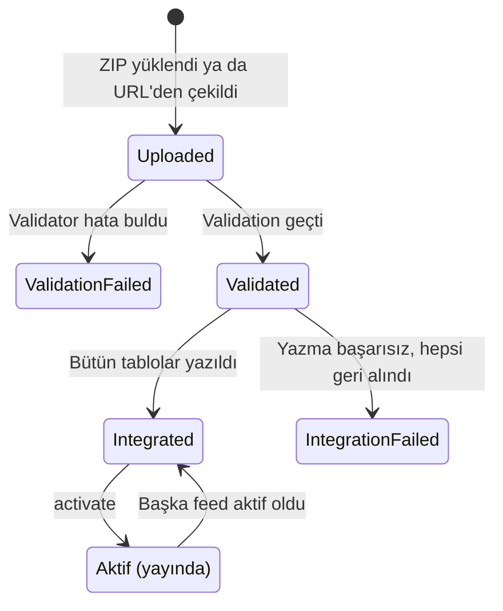
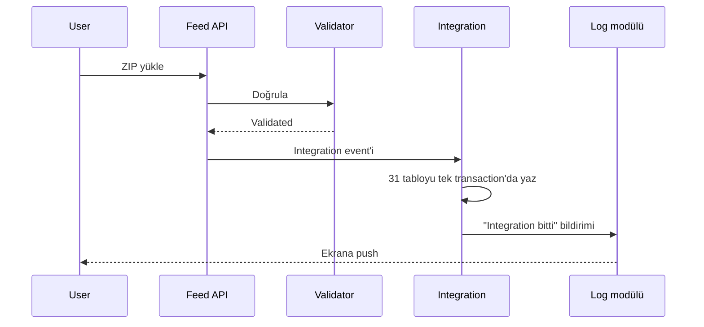
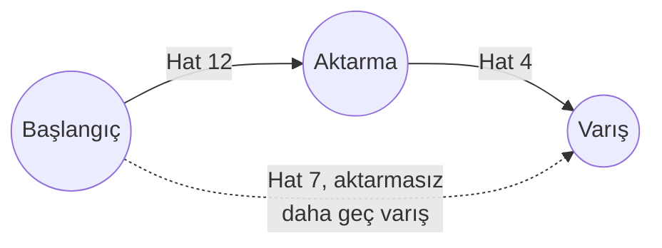

# Byd.GtfsManagement

Toplu taşıma tarifelerinin modülü. Bir organization'ın GTFS Schedule verisini (durak, hat, sefer, durak saati, takvim,
ücret ve diğerleri) import eder, MobilityData'nın resmi validator'ıyla doğrular, tablolara yazar, yayına alır ve tekrar
GTFS olarak export eder. Üstüne durak ve hat araması, harita, kalkış listesi ve journey planning ekler.



## Capabilities

| Capability | Ne sağlar |
|---|---|
| [Feed import](#feed-import) | GTFS ZIP'i file olarak ya da kaynak URL'den alma |
| [Validation](#validation) | MobilityData'nın resmi validator'ıyla doğrulama ve indirilebilir rapor |
| [Integration](#integration) | 31 GTFS file'ını tek transaction'da tablolara yazma |
| [Activate](#activate) | Organization'ın yayındaki tarifesini tek adımda değiştirme |
| [Summary ve export](#summary-ve-export) | Feed sayıları, servis aralığı ve tekrar GTFS ZIP |
| [GTFS kayıt yönetimi](#gtfs-kayıt-yönetimi) | Her GTFS varlığı için CRUD, aktif ya da eski feed üzerinde |
| [Durak ve hat araması](#durak-ve-hat-araması) | Elasticsearch ile arama, harita, detay ve kalkışlar |
| [Journey planning](#journey-planning) | İki durak arasında aktarmalı yolculuk önerileri |

## Feed yaşam döngüsü

Feed bir GTFS arşivinin sistemdeki karşılığıdır. Bir organization'ın birden çok feed'i olabilir ama aynı anda yalnız biri
yayındadır. Yeni feed yüklemek yayındaki tarifeyi değiştirmez; yayına almak ayrı bir karardır.



## Feed import

| Yol | Endpoint | Not |
|---|---|---|
| File upload | `POST feeds` | ZIP file modülüne kaydedilir |
| Kaynak URL | `POST feeds/import-from-source` | Local ve private network adresleri reddedilir; indirme external service log'a yazılır |

## Validation

Arşiv MobilityData GTFS Schedule Validator ile doğrulanır; host'un yanındaki Java CLI çalıştırılır. Rapor error, warning ve
info seviyelerini taşır ve `validation-report` endpoint'inden indirilir. Validator'a ulaşılamazsa feed `Uploaded`'da kalır
ve `validate` ile tekrar denenir.

## Integration

Doğrulanan feed'in her file'ı kendi tablosuna yazılır. Hangi file'ın hangi tabloya, hangi sırayla yazılacağı her import
DTO'sundaki `[GtfsFile]` attribute'unda durur; önce `agency`, `stops`, `routes`, sonra `trips`, en son `stop_times`
gibi. Yazma tek transaction'dır: bir file başarısız olursa hepsi geri alınır.



Integration distributed event'le başlar; event'le tamamlanamayan feed'leri bir worker periyodik olarak tekrar dener. Sonuç
user'a log modülünden notification olarak gider; ekran polling yapmaz.

## Activate

`activate` yalnız `Integrated` ve raporunda error olmayan feed'i kabul eder. Organization'ın önceki aktif feed'i pasife
alınır; GTFS satırları silinmez. Aktif feed değişince durak ve hat arama index'leri yeni feed'le yeniden doldurulur ve
diğer modüllere `FeedChangedEto` gider.

## Summary ve export

`summary` feed'in agency, durak, hat, sefer, durak saati, servis ve shape sayılarını ve takvimin kapsadığı ilk ve son
servis gününü döner. `export` feed'i tekrar standart GTFS ZIP olarak üretir.

## GTFS kayıt yönetimi

Her GTFS varlığının (`stops`, `routes`, `trips`, `stop-times`, ücret varlıkları ve diğerleri) aynı endpoint seti vardır:
create, get, `filtered-list`, update, delete. Default olarak aktif feed'in kayıtları döner; `feeds/{feedId}/...` ile eski
bir feed okunur. Validation kuralları GTFS şartnamesini izler: koordinat aralığı, saat formatı, renk kodu, feed dışı
referans, tekrarlı kayıt.

| Grup | GTFS file'ları |
|---|---|
| Temel | `agency`, `stops`, `routes`, `trips`, `stop_times`, `calendar`, `calendar_dates`, `feed_info` |
| Güzergah | `shapes`, `frequencies`, `transfers`, `levels`, `pathways` |
| Ücret | `fare_attributes`, `fare_rules` ve Fares v2 file'ları |
| Talebe bağlı ulaşım | `location_groups`, `location_group_stops`, `booking_rules` |
| Diğer | `attributions`, `translations` |

GTFS'teki sayısal kodlu alanlar (`route_type`, `location_type`, `wheelchair_boarding` gibi) seed edilen lookup
tablolarında durur.

## Durak ve hat araması

Aktif feed'in durakları ve hatları organization başına Elasticsearch'te index'lenir.

| Endpoint | Ne yapar |
|---|---|
| `stops/search`, `routes/search` | Ada ve koda göre hızlı arama |
| `stops/map` | Haritaya basılacak duraklar |
| `stops/{id}/detail`, `routes/{id}/detail` | Durak ya da hat detayı |
| `stops/{id}/departures` | Duraktan kalkan seferler |

## Journey planning

`journeys/plan` iki durak ya da istasyon arasında, verilen gün ve saatten sonra yola çıkan yolculukları hesaplar. Aktarma
sayısı default 2, en fazla 4'tür. Cevap her aktarma sayısı için en erken varan seçeneği taşır; daha az aktarmayla daha
erken varılıyorsa fazla aktarmalı seçenek elenir.



## Modülde kullanım

| Host ihtiyacı | Ne için |
|---|---|
| Java ve `gtfs-validator/gtfs-validator-cli.jar` | Validation |
| File modülü ve MinIO | ZIP arşivleri |
| Elasticsearch | Durak ve hat araması |
| RabbitMQ | Integration event'i |

Permission'lar varlık başına `GtfsManagement.<Varlık>.View` / `.Manage`; ek olarak `GtfsManagement.Feeds.Export` ve
`GtfsManagement.Journeys.View`.

## Geliştirme

```bash
dotnet build Byd.GtfsManagement.slnx
dotnet test Byd.GtfsManagement.slnx
```
