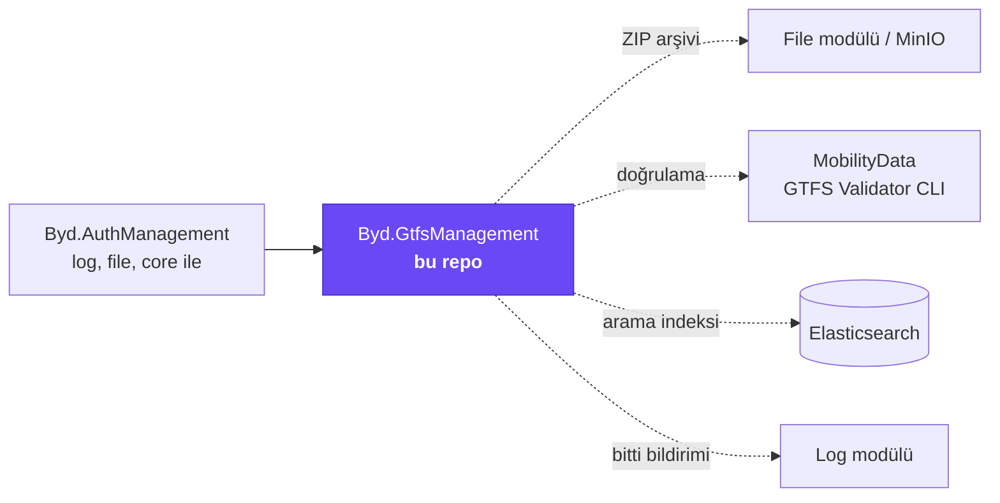
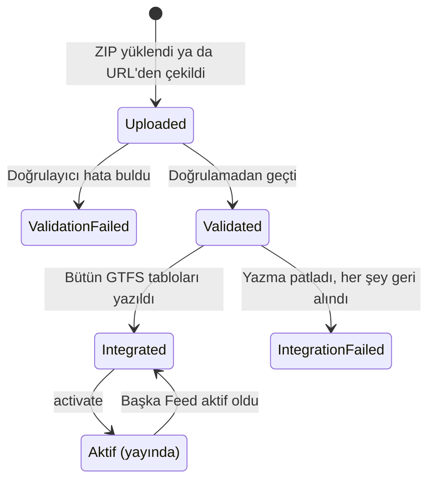
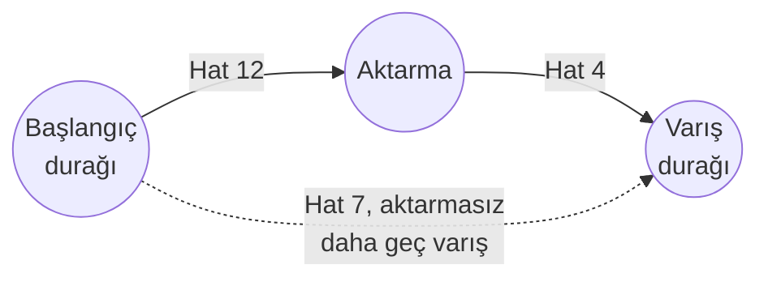
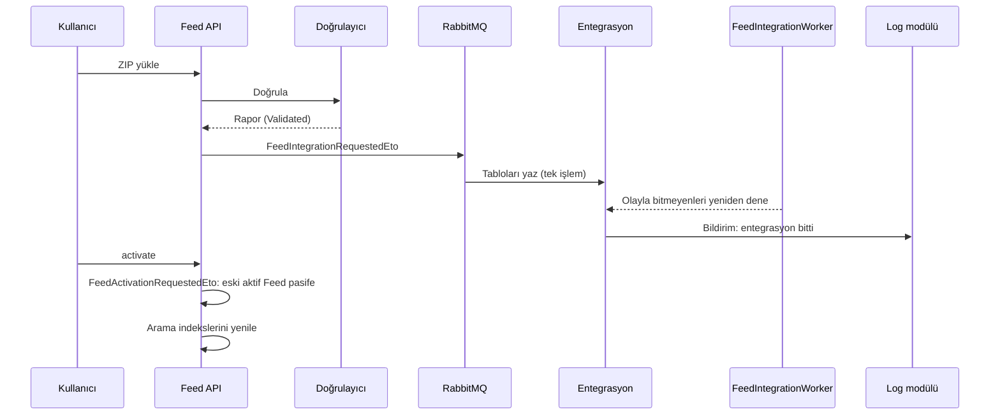

# Byd.GtfsManagement

[](https://www.nuget.org/packages/Byd.GtfsManagement.Domain)


Toplu taşıma tarifelerinin modülü. Bir organizasyonun GTFS Schedule verisini (duraklar, hatlar, seferler, durak saatleri,
takvimler, ücretler ve diğerleri) içe aktarır, MobilityData'nın resmi doğrulayıcısıyla doğrular, tablolara yazar, yayına
alır ve yeniden GTFS olarak dışa verir. Üstüne durak ve hat araması, harita, kalkış listesi ve iki durak arasında yolculuk
planlama ekler.

## İçindekiler

- [Platformdaki yeri](#platformdaki-yeri)
- [Bir bakışta](#bir-bakışta)
- [Feed yaşam döngüsü](#feed-yaşam-döngüsü)
- [Özellikler](#özellikler)
- [Desteklenen GTFS dosyaları](#desteklenen-gtfs-dosyaları)
- [HTTP uçları](#http-uçları)
- [Olaylar ve işçiler](#olaylar-ve-işçiler)
- [Yetkiler](#yetkiler)
- [Hata kodları](#hata-kodları)
- [Bir modülde kullanmak](#bir-modülde-kullanmak)
- [Geliştirme](#geliştirme)

## Platformdaki yeri



## Bir bakışta

| | |
|---|---|
| Paket ailesi | `Byd.GtfsManagement.*` |
| Sürüm | `0.1.0` (`common.props`) |
| Bağımlılık | `Byd.AuthManagement` 0.1.9, `Byd.LogManagement` 0.1.6 (file ve core onlarla gelir) |
| Veritabanı | PostgreSQL; her GTFS dosyası kendi tablosunda, satırlar Feed'e ve organizasyona bağlı |
| Doğrulayıcı | MobilityData GTFS Schedule Validator (Java CLI, `gtfs-validator/gtfs-validator-cli.jar`) |
| Arama | Elasticsearch: `gtfs_management_stops` ve `gtfs_management_routes` |
| Kapsam | Organizasyon; bir organizasyonun aynı anda tek aktif Feed'i olur |

## Feed yaşam döngüsü

Feed bir GTFS arşivinin sistemdeki karşılığıdır. ZIP önce file modülüne kaydedilir, sonra doğrulanır, sonra tablolara
yazılır; yayına alma ayrı bir adımdır.



| Durum | Anlamı |
|---|---|
| `Uploaded` | ZIP kaydedildi, doğrulama sonucu henüz yok |
| `ValidationFailed` | Doğrulayıcı hata buldu; GTFS tablolarına veri yazılmaz |
| `Validated` | Doğrulamadan geçti; entegrasyon kuyruğunda |
| `Integrated` | Bütün tablolar bu Feed'e yazıldı; yayına alınabilir |
| `IntegrationFailed` | Entegrasyon başarısız; yazılan her şey geri alındı |

## Özellikler

### 1. İçe aktarma

İki yol vardır:

| Yol | Uç | Not |
|---|---|---|
| Dosya yükleme | `POST feeds` | `FileName` (.zip) ve `Data` (base64); ad verilmezse dosya adı, zaman ve organizasyondan üretilir |
| Kaynak adresten | `POST feeds/import-from-source` | HTTP(S) adresi Feed'in `SourceUrl` alanında saklanır; yerel ve özel ağ hedefleri reddedilir, çağrı dış servis loguna yazılır |

Yeni Feed yayındaki Feed'i değiştirmez; yayına alma her zaman ayrı bir karardır.

### 2. Resmi doğrulayıcıyla doğrulama

Arşiv MobilityData'nın GTFS Schedule Validator'ıyla doğrulanır. Doğrulayıcı host'un çalıştığı klasördeki
`gtfs-validator` alt klasöründe duran Java CLI'dır; Java `JAVA_HOME`'dan bulunur. Rapor hata, uyarı ve bilgi seviyelerini
taşır ve `validation-report` ucundan indirilir. Doğrulayıcıya ulaşılamazsa Feed `Uploaded` durumunda kalır ve
`validate` ile yeniden denenir.

### 3. Entegrasyon

Doğrulanan Feed'in her dosyası kendi tablosuna yazılır. Eşleme merkezi bir listede değil, her dosyanın içe aktarma
DTO'sundaki `[GtfsFile(dosyaAdı, sıra)]` attribute'undadır; sıra, yabancı anahtar bağımlılıklarına göre dosyaların hangi
sırayla yazılacağını belirler (önce `agency`, `stops`, `routes`, sonra `trips`, en son `stop_times` gibi). Yazma tek
işlemdir: bir dosya patlarsa hepsi geri alınır.

Entegrasyon dağıtık olayla başlar; olayla tamamlanamayan Feed'leri `FeedIntegrationWorker` periyodik olarak yeniden dener.
İş bitince kullanıcıya log modülü üzerinden bildirim gider; arayüzün sorarak beklemesi gerekmez.

### 4. Yayına alma

`activate` yalnız `Integrated` ve raporunda hata olmayan Feed'i kabul eder. Organizasyonun önceki aktif Feed'i pasife
alınır; GTFS satırları değişmez. Aktif Feed değişince organizasyonun durak ve hat arama indeksleri o Feed'in kayıtlarıyla
yeniden doldurulur.

### 5. Feed özeti ve dışa aktarma

`summary` Feed'in ajans, durak, hat, sefer, durak saati, servis ve shape sayılarını ve takvimin kapsadığı ilk ve son
servis gününü döner. `export` Feed'i yeniden standart GTFS ZIP'i olarak üretir.

### 6. GTFS kayıtlarının yönetimi

Her GTFS varlığının kendi uç kümesi vardır: ekleme, okuma, filtreli liste, güncelleme, silme. Varsayılan olarak aktif
Feed'in kayıtları döner; `feeds/{feedId}/...` biçimindeki uçlar pasif bir Feed'in kayıtlarını okur. Doğrulama kuralları GTFS
şartnamesini izler: koordinat aralığı, saat biçimi, renk kodu, sıra numarası, Feed dışı referans, tekrarlı kayıt.

### 7. Durak ve hat araması

Aktif Feed'in durakları ve hatları organizasyon başına Elasticsearch'te indekslenir.

| Uç | Ne yapar |
|---|---|
| `stops/search`, `routes/search` | Ada ve koda göre hızlı arama |
| `stops/map` | Haritaya basılacak durak listesi |
| `stops/{id}/detail`, `routes/{id}/detail` | Durak ya da hattın ayrıntısı |
| `stops/{id}/departures` | Duraktan kalkan seferler |

### 8. Yolculuk planlama

`journeys/plan` iki durak (ya da istasyon) arasında, verilen gün ve saatten sonra yola çıkan yolculukları hesaplar. En
fazla aktarma sayısı varsayılan 2, en çok 4'tür. Cevap her aktarma sayısı için en erken varan seçeneği taşır; daha az
aktarmayla daha erken varılabiliyorsa fazla aktarmalı seçenek elenir.



## Desteklenen GTFS dosyaları

| Grup | Dosyalar |
|---|---|
| Temel | `agency`, `stops`, `routes`, `trips`, `stop_times`, `calendar`, `calendar_dates`, `feed_info` |
| Güzergah ve sıklık | `shapes`, `frequencies`, `transfers` |
| İstasyon içi | `levels`, `pathways` |
| Ücret (v1) | `fare_attributes`, `fare_rules` |
| Ücret (v2) | `timeframes`, `rider_categories`, `fare_media`, `fare_products`, `fare_leg_rules`, `fare_leg_join_rules`, `fare_transfer_rules`, `areas`, `stop_areas`, `networks`, `route_networks` |
| Talebe bağlı ulaşım | `location_groups`, `location_group_stops`, `booking_rules` |
| Diğer | `attributions`, `translations` |

GTFS'teki numaralı alanlar (`route_type`, `location_type`, `wheelchair_boarding`, `pickup_type`/`drop_off_type`,
`continuous_pickup`/`continuous_drop_off`, `bikes_allowed`, `cars_allowed`, `exception_type`, `direction_id` ve diğerleri)
lookup tablolarında tutulur ve seed edilir.

## HTTP uçları

**Feed**

| Yöntem | Yol | Ne yapar |
|---|---|---|
| `POST` | `api/gtfs-management/feeds` | ZIP yükler, doğrulamayı başlatır |
| `POST` | `api/gtfs-management/feeds/import-from-source` | Adresten çeker |
| `GET` | `api/gtfs-management/feeds/{id}` | Feed |
| `GET` | `api/gtfs-management/feeds/{id}/including-inactive` | Pasif Feed dahil |
| `GET` | `api/gtfs-management/feeds/filtered-list` | Filtreli liste |
| `POST` | `api/gtfs-management/feeds/{id}/validate` | Yeniden doğrular |
| `GET` | `api/gtfs-management/feeds/{id}/validation-report` | Doğrulama raporunu indirir |
| `POST` | `api/gtfs-management/feeds/{id}/activate` | Yayına alır |
| `GET` | `api/gtfs-management/feeds/{id}/summary` | Sayılar ve servis aralığı |
| `GET` | `api/gtfs-management/feeds/{id}/export` | GTFS ZIP olarak dışa verir |

**GTFS kayıtları** (her varlık için aynı küme; örnek `stops`)

| Yöntem | Yol | Ne yapar |
|---|---|---|
| `POST` | `api/gtfs-management/stops` | Ekler |
| `GET` | `api/gtfs-management/stops/{id}` | Tek kayıt |
| `GET` | `api/gtfs-management/stops/filtered-list` | Filtreli liste (aktif Feed) |
| `PUT` | `api/gtfs-management/stops/{id}` | Günceller |
| `DELETE` | `api/gtfs-management/stops/{id}` | Siler |
| `GET` | `api/gtfs-management/stops/feeds/{feedId}/filtered-list` | Belirli Feed'in listesi |
| `GET` | `api/gtfs-management/stops/feeds/{feedId}/{id}` | Belirli Feed'deki kayıt |

Varlıklar: `agencies`, `stops`, `routes`, `trips`, `stop-times`, `services`, `calendars`, `calendar-dates`, `shapes`,
`frequencies`, `transfers`, `levels`, `pathways`, `fare-attributes`, `fare-rules`, `timeframes`, `rider-categories`,
`fare-media`, `fare-products`, `fare-leg-rules`, `fare-leg-join-rules`, `fare-transfer-rules`, `areas`, `stop-areas`,
`networks`, `route-networks`, `location-groups`, `location-group-stops`, `booking-rules`, `feed-infos`, `attributions`,
`translations`.

**Arama ve planlama**

| Yöntem | Yol | Ne yapar |
|---|---|---|
| `GET` | `api/gtfs-management/stops/search` | Durak araması |
| `GET` | `api/gtfs-management/stops/map` | Harita için duraklar |
| `GET` | `api/gtfs-management/stops/{id}/detail` | Durak ayrıntısı |
| `GET` | `api/gtfs-management/stops/{id}/departures` | Kalkışlar |
| `GET` | `api/gtfs-management/routes/search` | Hat araması |
| `GET` | `api/gtfs-management/routes/{id}/detail` | Hat ayrıntısı |
| `GET` | `api/gtfs-management/journeys/plan` | Yolculuk planı |

## Olaylar ve işçiler



| Olay / işçi | Tür | Ne yapar |
|---|---|---|
| `FeedIntegrationRequestedEto` | Dağıtık | Doğrulanan Feed'i entegrasyona gönderir |
| `FeedActivationRequestedEto` | Yerel | Organizasyonun önceki aktif Feed'ini pasife alır, seçileni aktif yapar |
| `FeedChangedEto` | Dağıtık | Bir kayıt düzenlendiğinde ya da Feed yayına alındığında diğer modülleri bilgilendirir (`TenantId`, `OrganizationId`, `FeedId`) |
| Feed güncelleme handler'ı | Yerel | Aktif Feed'in durak ve hatlarını arama indeksine yazar |
| `FeedIntegrationWorker` | Periyodik işçi | Olayla tamamlanamayan `Validated` Feed'leri yeniden entegre eder |

## Yetkiler

Her GTFS varlığının `GtfsManagement.<Varlık>.View` ve `.Manage` izni vardır (`Agencies`, `Stops`, `Routes`, `Trips`,
`StopTimes`, `Services`, `Calendars`, `CalendarDates`, `Shapes`, `Frequencies`, `Transfers`, `Levels`, `Pathways`, ücret
varlıkları, `Areas`, `StopAreas`, `Networks`, `RouteNetworks`, `LocationGroups`, `LocationGroupStops`, `BookingRules`,
`FeedInfos`, `Attributions`, `Translations`).

| Ek izin | Ne verir |
|---|---|
| `GtfsManagement.Feeds.View` / `.Manage` | Feed'leri görmek / yüklemek, doğrulamak, yayına almak |
| `GtfsManagement.Feeds.Export` | Feed'i GTFS ZIP olarak dışa vermek |
| `GtfsManagement.Journeys.View` | Yolculuk planlamak |

## Hata kodları

`GtfsManagement:` önekiyle gelir; her GTFS varlığının kendi grubu vardır. Feed grubu kaynak ve doğrulayıcıyla ilgili
durumları da kapsar:

| Durum | Örnek |
|---|---|
| Kapsam | organizasyon zorunlu |
| Arşiv | dosya adı, uzantı, içerik eksik |
| Kaynak adres | ayarlanmamış, erişilemiyor |
| Doğrulayıcı | ayarlanmamış, erişilemiyor, rapor okunamadı |
| GTFS kuralları | koordinat aralık dışı, saat biçimi hatalı, Feed dışı referans, tekrarlı kayıt, yolculukta duraklar farklı Feed'lerde |

## Bir modülde kullanmak

| Tüketen katman | Paket | Modül sınıfı |
|---|---|---|
| `<Modül>.Domain.Shared` | `Byd.GtfsManagement.Domain.Shared` | `GtfsManagementDomainSharedModule` |
| `<Modül>.Domain` | `Byd.GtfsManagement.Domain` | `GtfsManagementDomainModule` |
| `<Modül>.Application.Contracts` | `Byd.GtfsManagement.Application.Contracts` | `GtfsManagementApplicationContractsModule` |
| `<Modül>.Application` | `Byd.GtfsManagement.Application` | `GtfsManagementApplicationModule` |
| `<Modül>.EntityFrameworkCore` | `Byd.GtfsManagement.EntityFrameworkCore` | `GtfsManagementEntityFrameworkCoreModule` |
| `<Modül>.HttpApi` | `Byd.GtfsManagement.HttpApi` | `GtfsManagementHttpApiModule` |

**Host**

| Gereken | Neden |
|---|---|
| Core, log ve auth host sözleşmesi | Zincirin bütün modülleri |
| Java ve `gtfs-validator/gtfs-validator-cli.jar` | Doğrulama; Java `JAVA_HOME`'dan bulunur |
| File modülü ve MinIO | ZIP arşivleri |
| Elasticsearch (core ayarları) | Durak ve hat araması |
| `RabbitMQ` bölümü | Entegrasyon olayı |

## Geliştirme

```bash
dotnet build Byd.GtfsManagement.slnx
dotnet test Byd.GtfsManagement.slnx
```

Host `host/Byd.GtfsManagement.HttpApi.Host` altındadır; repo kökünde bir `Dockerfile` vardır.
